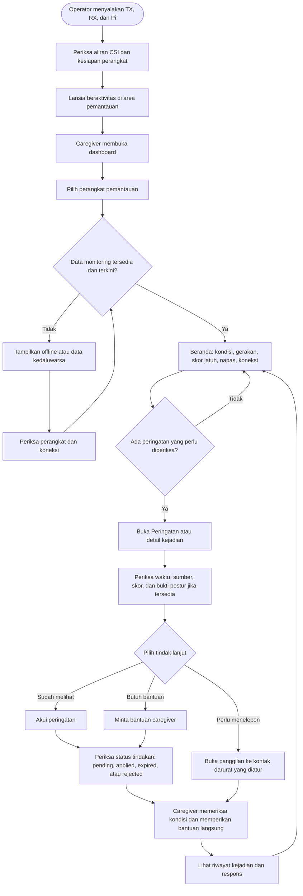
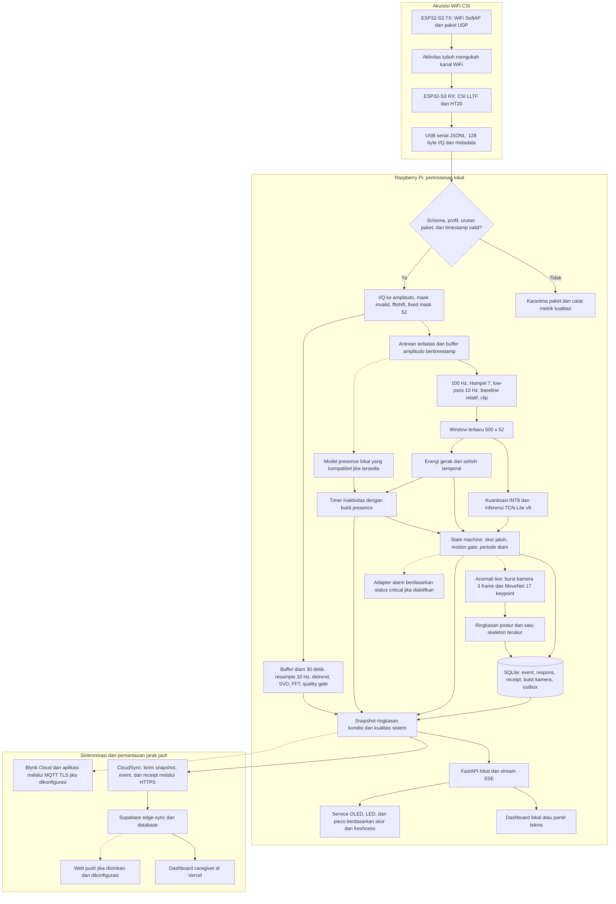
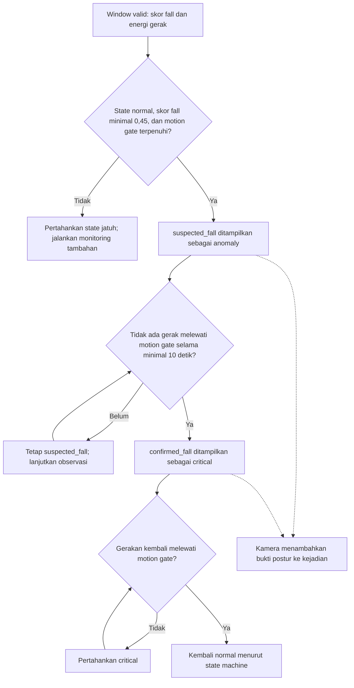
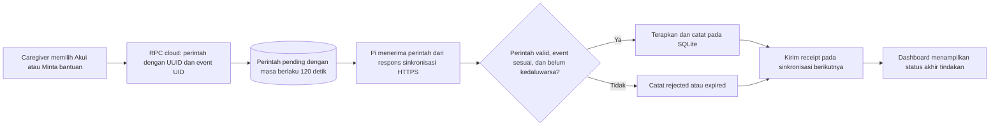
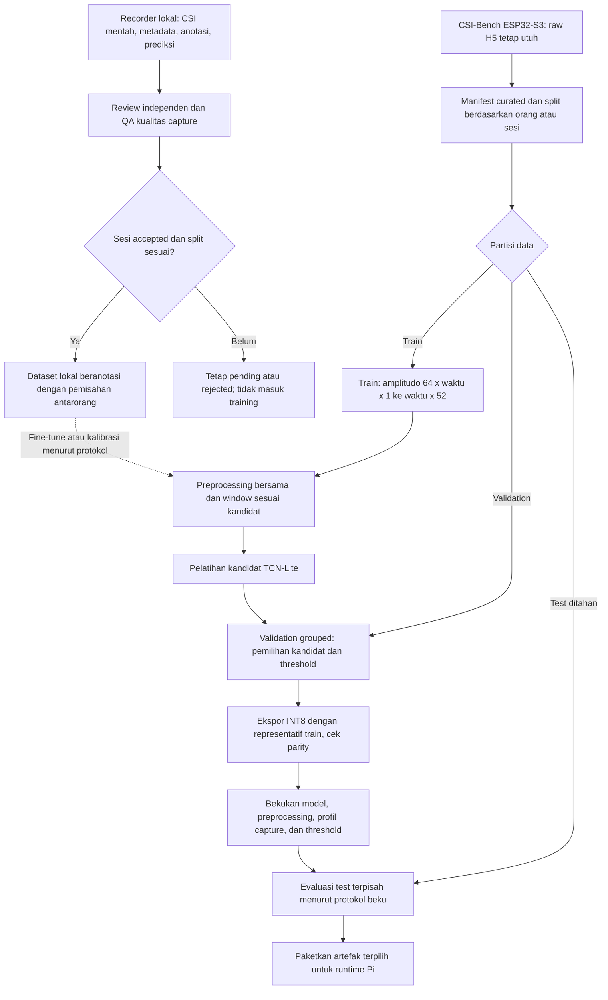

# Flow Program SRASTA

Snapshot implementasi lokal yang diperiksa pada 23 Oktober 2026. Dokumen ini
menjelaskan program yang tersedia, termasuk konfigurasi opsional dan batas
integrasi saat ini. Ini bukan hasil uji perangkat atau validasi akurasi baru.

Konteks produk mengikuti [proposal SRASTA](https://docs.google.com/document/d/15EJxdUXP2X9X5V8FEKO8p9wN2s1fkgW3l0qTIBnsN_s/edit).
Perilaku implementasi mengikuti source, konfigurasi model terpilih, dan tes repo.

## 1. Aktor dan perannya

| Aktor | Peran dalam alur |
| --- | --- |
| Operator atau pemasang | Menyiapkan TX, RX, Pi, kamera dan indikator; memeriksa koneksi serta kualitas CSI. |
| Lansia atau orang yang dipantau | Beraktivitas di area sensing tanpa perlu memakai wearable atau mengoperasikan dashboard. |
| Caregiver | Membuka dashboard, memeriksa status dan bukti kejadian, mencatat respons, serta melakukan tindak lanjut langsung. |
| Pengembang atau pengumpul data | Merekam sesi beranotasi, melakukan QA, melatih kandidat dan mengevaluasi sebelum memilih model. |

## 2. User flow pemantauan dan respons

Mode dashboard publik tidak meminta login. Mode cloud privat tetap menggunakan
akun caregiver. Dashboard lokal membaca API Pi; pengaturan bind lokal dan SSH
forwarding mengikuti runbook, bukan membuka port Pi langsung ke internet.

- Caregiver dapat membuka Beranda, Peringatan, Riwayat, Perangkat, dan Pengaturan.
- Pengaturan menyimpan alias orang/ruangan dan kontak darurat di browser untuk
  perangkat tersebut. Push memerlukan izin pengguna dan konfigurasi pendukung.
- Akui mencatat respons caregiver. Tindakan ini tidak mengubah kondisi kritis
  menjadi normal atau membatalkan keputusan model.
- Minta bantuan mencatat permintaan di edge. Program tidak otomatis menelepon;
  tombol panggilan menggunakan tautan telepon dan memerlukan tindakan pengguna.
- Status koneksi dan umur data diperiksa terpisah dari status kejadian. CSI putus
  tidak boleh diartikan sebagai ruangan kosong atau diam setelah jatuh.

## 3. Data flow sensing, analisis, dan distribusi

Garis putus-putus menandai jalur yang bersyarat atau opsional. Cabang presence
memerlukan model lokal yang kompatibel dan diterima; model publik riset tidak
otomatis masuk jalur live.

### Detail jalur utama

1. TX dan RX memakai jaringan sensing tersendiri. RX menangkap CSI, bukan
   mengerjakan inferensi model. Jalur firmware saat ini menggunakan channel 6
   dan USB serial 1.000.000 baud.
2. Decoder menerima tepat 128 signed byte dengan pasangan imaginary-real.
   Setelah menjadi 64 amplitudo, invalid word dimasking pada koordinat asli.
   Profil `esp_idf_native` melakukan `fftshift`, kemudian mask tetap indeks
   `6..31` dan `33..58` menghasilkan 52 fitur.
3. Preprocessing memakai zero-order hold berdasarkan timestamp ke 100 Hz,
   Hampel dengan 7 sampel riwayat filtered, low-pass orde satu 10 Hz,
   normalisasi relatif terhadap baseline adaptif, dan clipping -2 sampai 2.
   Config artefak mengizinkan gap 0,05 detik; wrapper live mengubahnya menjadi
   0,15 detik. Gap besar mereset buffer kontinuitas sebelum window baru dibentuk.
4. Window 500 x 52 mewakili sekitar lima detik pada grid 100 Hz. Input model
   ditambah dimensi batch menjadi `[1,500,52]` dan dikuantisasi ke INT8.
5. Model menghasilkan skor nonfall/fall. Energi gerak dihitung terpisah dari
   perubahan antarwaktu pada window hasil preprocessing.
6. Napas memiliki cabang tersendiri dari amplitudo hasil decoder, bukan dari
   tensor fall yang sudah dinormalisasi. Gerakan besar mereset buffer napas;
   estimasi memerlukan sekitar 30 detik data dan pemeriksaan kualitas periodisitas.
7. Kamera hanya dipicu oleh kejadian live anomali/kritis yang fresh dan valid.
   Tiga frame diproses lokal oleh MoveNet. Minimal dua postur andal yang searah,
   tanpa postur andal yang bertentangan, diperlukan untuk hasil yang konsisten.
8. SQLite menyimpan event dan outbox. CloudSync mengirim ringkasan berkala
   (default 5 detik), mencoba kembali saat gagal, dan mempertahankan event lokal.
   Dashboard publik membaca RPC terbatas; mode cloud privat memakai akses akun.
9. Ringkasan yang dikirim berisi status, skor, timestamp, energi gerak, mutu
   sinyal, estimasi napas, event, receipt, dan skeleton terbatas. Raw CSI,
   MAC pengirim, serta citra/video kamera tidak dimasukkan ke snapshot caregiver.

## 4. Alur keputusan status pada implementasi sekarang

| Status dashboard | Sumber keputusan saat ini |
| --- | --- |
| `standby` | Presence secara eksplisit menyatakan empty; memerlukan model presence yang tersedia dan kompatibel. |
| `normal` | Tidak sedang suspected/confirmed fall dan tidak ada status tambahan yang lebih tinggi; cek pula flag online/verified. |
| `inactive` | Presence menyatakan orang ada dan tidak bergerak melewati timer inaktivitas, default 60 detik. |
| `anomaly` | Jalur fall menghasilkan `suspected_fall`. |
| `critical` | Jalur fall menghasilkan `confirmed_fall` setelah periode diam 10 detik. |

Motion gate v8 terserialisasi adalah sekitar 0,00034438. Prioritas public state
adalah critical, anomaly, inactive, standby, lalu normal.

### Batas integrasi yang perlu disampaikan pada presentasi

- Model fall terpilih masih biner nonfall/fall. Lima status dashboard dibentuk
  oleh logika program; itu bukan lima kelas keluaran model TCN saat ini.
- Kamera menambahkan bukti postur. Hasil kamera belum menjadi masukan yang
  mengubah atau membatalkan transisi state machine fall.
- Estimator SVD-FFT napas sudah diimplementasikan. Klasifikasi kondisi
  `empty/sleep/normal` masih jalur riset; `breathing_condition` pada monitor
  runtime tetap belum terisi. Napas abnormal belum otomatis memicu critical.
- Loader presence lokal tersedia, tetapi handoff 23 Oktober belum memiliki
  model presence lokal accepted untuk jalur live. Karena itu, hasil presence
  dapat unknown dan standby/inactive tidak boleh diasumsikan sudah terukur.
- Panel lokal mempunyai aturan skor tersendiri: di bawah 75% hijau, 75 sampai
  kurang dari 85% kuning, minimal 85% merah. Piezo mengikuti aturan panel.
  Ini berbeda dari threshold fall 0,45 dan timer state machine. Adapter alarm
  critical merupakan jalur terpisah dan dapat dinonaktifkan lewat konfigurasi.
- Konfirmasi program tidak sama dengan pemeriksaan manusia atau validasi
  medis. Flow ini menjelaskan perilaku software, bukan klaim akurasi lapangan.

## 5. Data flow tindakan balik caregiver

Pada mode lokal, dashboard mengirim langsung ke `POST /api/commands`, lalu
memperoleh receipt dari Pi. Jalur Blynk memakai callback ACK dan bantuan sendiri.
Perintah remote tidak membutuhkan port inbound publik pada Pi: Pi mengambilnya
melalui koneksi outbound CloudSync. ID yang sama mencegah penerapan ganda.

Jika internet putus, monitoring edge dan pencatatan lokal tetap berjalan selama
perangkat sensing dan runtime sehat; dashboard remote menjadi stale/offline.
Perintah yang belum diterapkan dapat kedaluwarsa dan tidak dianggap berhasil.
Jika serial terputus, reader mencoba reconnect dan mereset kontinuitas buffer;
putusnya data tidak dihitung sebagai bukti diam pascajatuh.

## 6. Data flow pengembangan dan training

Flow training berjalan offline dan terpisah dari monitoring. Respons caregiver
bukan label training otomatis. Data eksternal hanya boleh mengikuti aturan domain,
lisensi dan pemisahan test di AGENTS.md. Model demo terpilih tetap v8; eksperimen
Hampel raw 23 Oktober tidak dipromosikan. Handoff lokal mencatat 0 window train
dan validation accepted pada pemeriksaan readiness saat itu.

## 7. Narasi presentasi singkat

“SRASTA memiliki tiga aktor utama dalam pemantauan: operator menyiapkan
perangkat, lansia beraktivitas tanpa memakai wearable, dan caregiver memantau
kondisi melalui dashboard. Dua ESP32-S3 menangkap perubahan kanal WiFi,
kemudian Raspberry Pi mengolah CSI dan menjalankan model secara lokal.
Hasil inferensi dipadukan dengan energi gerak serta durasi diam untuk
menentukan status. Ketika muncul anomali, kamera dapat menambahkan bukti
postur tanpa melakukan perekaman visual terus-menerus. Ringkasan kondisi
dan kejadian disimpan lokal serta disinkronkan ke dashboard caregiver.
Caregiver dapat mengakui peringatan, meminta bantuan, atau melakukan
panggilan manual. Setiap tindakan dicatat dan memiliki status konfirmasi
dari perangkat. Cabang presence dan klasifikasi kondisi napas tetap
menjadi bagian produk, dengan integrasi dan validasi lokal yang masih
harus diselesaikan.”

## 8. Acuan implementasi

- [Handoff saat ini](../HANDOFF.md)
- [Kontrak dan decoder CSI](../code/srasta_csi/decoder.py)
- [Preprocessing bersama](../code/srasta_csi/preprocess.py)
- [State machine, buffer, inferensi dan API](../code/srasta_csi/edge.py)
- [Config model v8](../artifacts/releases/20261001-tcn-v8-motion-calibrated/selected/preprocess_config.json)
- [Snapshot caregiver](../code/srasta_csi/caregiver.py)
- [Monitoring napas](../code/srasta_csi/breathing.py)
- [Presence dan inaktivitas](../code/srasta_csi/monitoring.py)
- [Kamera event dan voting postur](../code/srasta_csi/camera.py)
- [CloudSync dan perintah balik](../code/srasta_csi/cloud_sync.py)
- [Koneksi dashboard dan RPC](../web/src/connection.ts)
- [Respons caregiver pada detail kejadian](../web/src/event-detail.tsx)
- [Panel OLED, LED dan piezo](PI_DEVICE_PANEL.md)
- [Batas kesiapan model dan data lokal](FALL_ENGINEERING_HANDOFF.md)
